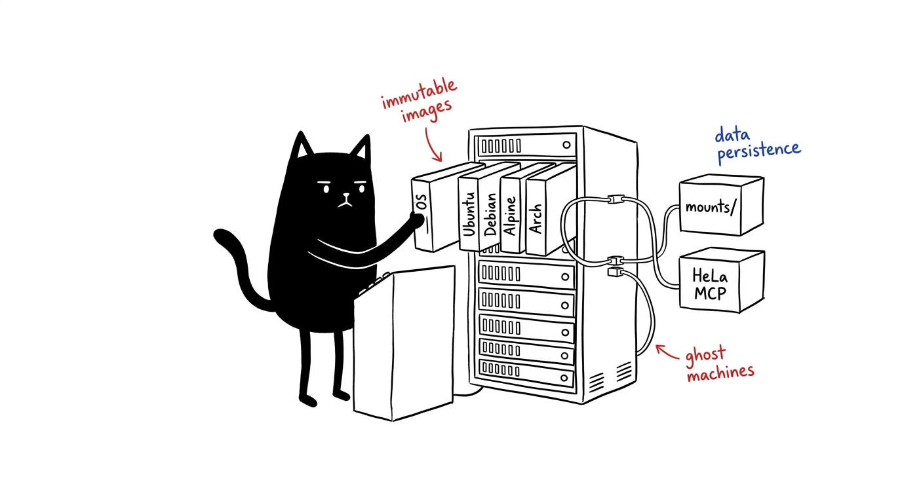

# Ghost Machines

Disposable, multi-engine Linux sandboxes and autonomous agent workstations, orchestrated with Docker Compose. Reproducible environments with host UID/GID sync, non-root execution, accurate resource reporting via LXCFS, optional Cloudflare Tunnel access, and the HeLa MCP + agent stack pre-wired.



[](https://asciinema.org/a/sDNJP7aYOabLz0k6)

## In one minute

```bash
git clone https://github.com/1999AZZAR/ghost-machines.git
cd ghost-machines
make setup-host                          # Linux: LXCFS, once
./start.sh --prebuilt ubuntu -m single   # pull the image, 1 machine
ssh -p 2223 developer@localhost          # password: ghost
```

Then, when you are done:

```bash
./start.sh stop        # containers go away, mounts/ and images stay
```

Full walkthrough, including the local-build alternative: **[docs/getting-started.md](docs/getting-started.md)**.

## What you get

| | |
| :--- | :--- |
| **Four engines** | Ubuntu, Debian, Alpine, Arch — same toolchain, published multi-arch (`amd64`/`arm64`) images. |
| **Two image sources** | Prebuilt GHCR (pull, ~1 min) or local build (5–15 min). Same resolution rules, no surprises. |
| **Real permissions** | `developer` account synced to your host UID/GID; work lives in `mounts/` on the host, never in the container. |
| **Agent stack** | OpenCode v2, Antigravity CLI (`agy`), RTK, HeLa MCP wrappers, Google Conductor — refreshed to latest on every start. |
| **Multi-tenant** | `tenant.sh` gives each user an isolated container, port, quota and workspace. |
| **Disposable by design** | Stop, rebuild, re-pull — your files survive. Snapshots with SHA-256 verification and atomic restore. |
| **Optional remote access** | Cloudflare Tunnel profile, no port-forwarding. |

## Documentation

Start at the **[docs index](docs/README.md)** (or the [web version](https://ghost.glassgallery.my.id), rebuilt automatically from `docs/` on every push to `master`).

| If you want to… | Read |
| :--- | :--- |
| Install and connect in five minutes | [Getting Started](docs/getting-started.md) |
| Choose prebuilt vs local build, pin a version, upgrade or roll back | [Images](docs/images.md) |
| Know what is installed and which engine to pick | [Engines & Toolchain](docs/engines.md) |
| Start, stop, pause, restart, back up or delete safely | [Lifecycle & Cleanup](docs/lifecycle.md) |
| SSH in, use keys, forward a dev server, open it in an IDE | [Connecting](docs/connecting.md) |
| Look up an environment variable | [Configuration](docs/configuration.md) |
| Understand the boot sequence and components | [Architecture](docs/architecture.md) |
| Give several people their own sandbox | [Multi-Tenant](docs/tenants.md) |
| Harden a sandbox before exposing it | [Security & Hardening](docs/security.md) |
| Fix something | [Troubleshooting](docs/troubleshooting.md) |
| Just have the commands on one page | [Cheatsheet](docs/cheatsheet.md) |
| Modify images, add an engine, release | [Contributing](docs/contributing.md) |

## Quick reference

```bash
./start.sh --prebuilt debian -m single --pull   # newest image
./start.sh -e arch -m power --build             # local build, heavy profile
./start.sh status                               # containers, images, SSH ports
./start.sh stop                                 # remove containers, keep work
make snapshot && make restore                   # backup / restore mounts/
./tenant.sh add alice --prebuilt --engine debian --cpu 2 --mem 4G
```

Default credentials: `developer` / `ghost`, and `sudo` uses the same password. **These are dev defaults — read [Security](docs/security.md) before exposing a sandbox.**

## Requirements

Docker Engine 20.10+ with Compose v2, on Linux, macOS (Docker Desktop/OrbStack) or Windows (WSL2), `x86_64` or `arm64`. LXCFS is optional and Linux-only.

## Project layout

```text
start.sh / clean.sh / tenant.sh      orchestration and lifecycle
snapshot.sh / restore.sh             backup with verification
entrypoint.sh                        first boot inside the container
harness-update.sh                    keeps opencode, agy, rtk on latest
Dockerfile, Dockerfile.debian,       four engine images
Dockerfile.alpine, Dockerfile.arch
docker-compose.yml                   main topology (+ templates/ for tenants)
tests/                               bash suites, incl. doc/code parity checks
docs/                                markdown source; docs/site is generated
```

## Development

```bash
make lint     # shellcheck, bash -n, compose schema
make test     # 9 suites: lint, security, engines, CLI, snapshot, MCP, toolchain, tenants, docs
make docs     # regenerate the static site from docs/*.md
```

See [Contributing](docs/contributing.md) for the test matrix, documentation rules and release process.

## License

MIT — see [LICENSE](LICENSE). Bundled upstream tools keep their own licenses.
